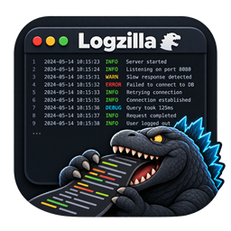

# Logzilla

**A log analyzer for very large files.**

**[Download the latest version](https://github.com/RayonN23/Logzilla/releases/latest)** · [Report a bug or suggest a feature](https://github.com/RayonN23/Logzilla/issues)

A Windows desktop application for logs that are too big, too many, or too noisy
to work through by hand. It opens multi-gigabyte logs in seconds, merges several
of them onto one timeline, reads structured JSON logs as readable sentences
instead of raw objects, filters on any field the log records, and — if you turn
it on — answers questions about the log in plain words.

It runs entirely on your own machine. Nothing is uploaded anywhere unless you
turn on the AI assistant and ask it something, which matters when logs carry
customer device IDs, hostnames and internal addresses.

---

## Install

Download `Logzilla-Setup.exe` from
[Releases](https://github.com/RayonN23/Logzilla/releases/latest) and run it.

Nothing else is needed. The installer carries the application inside it, the
application bundles its own .NET runtime, and everything is written under your
own profile — so there is no prerequisite to install and no administrator prompt.
Both executables carry full version information, so Windows names the publisher
and version in file properties, Task Manager and the trust prompt.

| | |
|---|---|
| `Logzilla-Setup.exe` | Install |
| `Logzilla-Setup.exe /silent` | Install with no output |
| `Logzilla-Setup.exe /uninstall` | Remove it |
| `Logzilla-Setup.exe /dir=D:\Tools\Logzilla` | Install somewhere else |

It also appears in **Settings › Apps** like any other program.

> **Making it the default for `.log` files**
> Windows deliberately stops an installer from seizing a file association. The
> installer registers the type and adds the app to *Open with*; to finish, right-click
> a `.log` file → **Open with** → **Choose another app** → **Logzilla** →
> tick *Always use this app*. Notepad++ needs the same step.

## What it does

**Reads the whole file, not a window into it.** The file is never fully decoded.
Indexing and search run over raw bytes and only the rows on screen become text,
so file size is bounded by disk rather than memory — about 24 bytes of index per
line. A 1 GB log indexes in roughly nine seconds, and typing in the Find box
never freezes the window: scans run in the background and are abandoned the
moment the query changes.

**Understands the timestamp.** Detected from the file itself, with no
configuration:

| Format | Example |
|---|---|
| ISO 8601 | `2026-03-01 08:14:02.113` |
| Slash dates | `2026/03/01 08:14:02` |
| Apache / IIS (CLF) | `01/Mar/2026:08:14:02 +0000` |
| US short date | `3/1/2026 8:14:02 AM` |
| Syslog | `Mar  1 08:14:02` |
| Time only | `08:14:02.113` (rolls over correctly at midnight) |

Severity is read from the line and shown in its own colour-coded column. UTF-8,
ANSI and UTF-16 (both byte orders) are handled, with byte order marks detected
automatically.

**Shows times in local time or UTC.** The **Log time / Local time / UTC** chip
picks the clock every time on screen is read in; log time is exactly what the file
wrote. Stamps that carry a zone (`Z`, `+02:00`, CLF's `+0000`, CLEF's `@t`)
convert on their own, daylight saving included. Stamps
with no zone are never guessed. You are asked once whether they are local time, UTC
or another offset, and the answer is remembered per file. The file's last-modified
time is offered as a hint when it points one way.

**Merges by time.** Open several logs and press **Merge** in the command bar, or
<kbd>Ctrl</kbd>+<kbd>M</kbd>. Entries interleave onto one timeline with a
colour-coded source column, even when the files use different formats or time
zones: files whose zone is known are ordered by the moment each line happened. Stack
traces stay attached to the entry above them, and each source can be hidden or
shown from the Sources panel without redoing the merge. This is what turns "the
gateway logged a timeout" and "the service logged a connection reset" into one
story.

**Reads JSON logs.** Serilog CLEF, pino, bunyan, Elastic ECS and plain NDJSON are
detected from the file itself. Message templates are filled in, so
`{Name}.ProcessMaintenance: {CommandType}` displays as
`MaintenanceCommandManager.ProcessMaintenance: DeviceInformation`. Exceptions are
unescaped into readable text with their real line breaks, and **Show raw lines**
puts the original JSON back whenever you need it.

**Searches whole entries.** `timeout retry` (both words) · `"connection reset"`
(phrase) · `-heartbeat` (exclude) · `.*` (regular expression) · `Aa` (match
case). A query is answered against the whole entry, so a term buried in a stack
trace still finds the error line it belongs to, and two terms count even when
they are several lines apart. **Filter** hides non-matching entries;
**Highlight** keeps them visible and just marks the hits, with optional context
lines around each match.

**Filters by field.** Pick a field the log actually records — `CorrelationId`,
`Feature`, `RequestPath`, a tenant, a status code — and choose **is**,
**contains** or **is not**. Several values on one field match any of them
(`Feature is DeviceAction or Sync`); filters on different fields must all hold.
It works on JSON properties (nested ones too) and on `key=value` pairs in
plain-text logs, and a field on a stack-trace line counts for the entry above
it. Open the editor with **+ Field filter** or
<kbd>Ctrl</kbd>+<kbd>Shift</kbd>+<kbd>F</kbd>; it lists the log's own fields and
values with counts. Active filters show as chips — click to edit, × to remove,
right-click to flip is / is not. Right-click any entry for **Show only where…** /
**Hide where…**, or click a value in the Fields panel. A field filter over a
330 MB log comes back in under half a second.

**Narrows by time.** Drag across the timeline histogram to select a range,
double-click it to clear, click once to jump there. Or type into the **TIME** box
(`20:00 - 21:00`, `8pm - 9pm`, `2026-01-15 08:00 - 09:30`). The Summary panel's
busiest error windows jump straight to the start of an incident.

**Finds the shape of the noise.** The Patterns panel collapses variable parts —
`latency=812ms` and `latency=41ms` become one shape — so a million lines reduce to
a few dozen distinct things ranked by frequency. For CLEF logs the grouping is
exact, because the log already carries the message template. The rare shapes sort
to the bottom, and the rare shapes are usually the problem.

**Selects, bookmarks, copies and exports.** Drag down the rows, Shift+click, or hold
Shift with any movement key to select a run; <kbd>Ctrl</kbd>+<kbd>A</kbd> takes
every entry shown. <kbd>Ctrl</kbd>+<kbd>C</kbd> copies the entries as they read on
screen, one per line, with source labels in a merged view. <kbd>M</kbd> bookmarks the
selection so you can collect the lines that belong in a ticket and copy them all
from the Bookmarks panel later. <kbd>Ctrl</kbd>+<kbd>E</kbd> exports exactly the
filtered entries to a new file, preserving the original text.

**Follows a live file.** **Live tail** keeps reading a log as it is written, like
`tail -f`, with the index extended incrementally.

**Answers questions about the log.** The **AI Chat** tab takes a question in plain
words — *"what went wrong around 08:14?"* — and answers from the log itself,
citing the lines it relied on. It works with GitHub Copilot, Claude or OpenAI, is
off until you turn it on, and hides personal data before anything is sent. See
[The AI assistant](#the-ai-assistant).

### The analysis panels

Eight tabs in the inspector, each answering a question about the entries
currently shown. <kbd>Ctrl</kbd>+<kbd>1</kbd>..<kbd>8</kbd> switch between them.

| Panel | What it shows |
|---|---|
| **Summary** | Counts, file size, time span, entries per minute, error count and percentage, a log-scale severity breakdown, and the busiest error windows |
| **Detail** | The selected entry in full: timestamp, severity, byte offset, source, the rendered message, a property table, the exception, and the raw line. Embedded XML (plists, SOAP bodies) is indented |
| **Fields** | Distinct values with counts — JSON property names, `key=value` pairs, IP addresses, `[bracketed tags]`. Click a value to filter to it, Ctrl+click to hide it |
| **Patterns** | Entries grouped by shape, ranked by frequency, coloured by worst severity. Click to jump, Ctrl+click to filter |
| **Bookmarks** | Bookmarked entries in order, ready to copy into a ticket or post-mortem |
| **Sources** | Each file in a merged view with its share of entries; click to show or hide it |
| **Highlighting** | Highlight any text or regex in a colour of its own: type it at the top of the tab and press Enter; right-click a highlight to recolour or remove it. Also saves and loads a setup file (highlights, query, levels and field filters) to share with a team |
| **AI Chat** | The AI assistant: ask about the log in plain words, with answers that cite their lines |

### Getting around

- **Timeline** — entry volume over time with warnings and errors stacked in
  colour; hover for exact counts.
- **Minimap** — error density for the whole file, not just what is on screen,
  with bookmarks shown in amber. Click to jump.
- **Tabs** — one per open file, with its entry count and worst severity; merged
  views get their own tab.
- **Long lines** — a horizontal scrollbar (and Shift+wheel) reaches anything past
  the right edge, or the **Wrap** chip folds long messages onto several lines.
- **Log time / Local time / UTC** chip — the clock times are shown in; click to cycle,
  right-click to choose. View › Time zone of this file sets the zone of stamps that
  carry none.
- **Date** chip — collapses the date-and-time column and gives its width to the
  message; a once-a-day band keeps the date visible.

## The AI assistant

### Using it

1. Open **Tools › AI settings** and tick **Turn on the AI assistant**.
2. Connect at least one provider:
   - **GitHub Copilot** uses your existing Copilot subscription and offers every
     model your plan and organisation allow. Click **Sign in with GitHub**: Logzilla
     shows a short code, you approve it on github.com in your browser, and you're
     done — your password never passes through Logzilla. Copilot also needs its
     runtime: install the [GitHub Copilot CLI](https://docs.github.com/copilot). An
     existing Copilot CLI sign-in, or a pasted fine-grained token, works too.
   - **Claude** or **OpenAI** take an API key from your account with them. An
     optional endpoint points either at your organisation's own gateway or at
     Azure OpenAI.
3. Open the **AI Chat** tab (<kbd>Ctrl</kbd>+<kbd>8</kbd>), pick a model from the list
   at the top, and ask.

The assistant reads the log through the same engine as the rest of the app: it
searches, counts, reads entries around a line, groups entries into patterns and
lists fields. A multi-gigabyte file never goes to the model, only the handful of
results each question needs.

- **Line numbers** in an answer, like `#4,211`, jump to that line when clicked.
- **Apply** next to a search the assistant ran turns it into your own filters.
- **Looking at** switches between the whole log and only what your filters show.
- Right-click an entry › **Ask AI about this entry** asks for an explanation.
- **••• › What was sent** shows exactly what left your computer in this session.
- **Token usage** appears under every answer (tokens in and out, and model calls),
  the conversation total sits at the top right of the tab, and **••• › Usage in
  this conversation** adds cached tokens, GitHub Copilot premium requests and how
  full the model's context window is. Counts are as each provider reports them.

### Privacy and security

- **Off by default.** Nothing is sent anywhere until the assistant is turned on
  *and* you ask a question.
- **Personal data is hidden.** Email and IP addresses, GUIDs, passwords, API keys,
  tokens and connection-string secrets are replaced with placeholders such as
  `«IP_1»` before anything is sent. The same value always gets the same
  placeholder, so the model can still connect events, and the real values are put
  back only on your screen.
- **Read-only.** The model can call Logzilla's read-only log tools and nothing
  else — it cannot write files, run commands or reach the web. For Copilot, whose
  agent normally has a shell and file tools, the session is locked to Logzilla's
  tools, every other permission is refused, and your own Copilot instructions,
  skills and MCP servers are left out.
- **Prompt injection.** Log lines are written partly by outsiders. The assistant
  is told never to follow instructions found in the log, and even if it did,
  it has nothing dangerous to do.
- **Keys** are encrypted with Windows DPAPI for your account and are never written
  to setup (`.cnx`) files.
- **A record.** Optionally, everything sent is appended to a daily file in
  `%APPDATA%\Logzilla\ai-record`.

### For administrators

Group Policy or Intune can control the assistant through values under
`HKLM\SOFTWARE\Policies\Logzilla` (or `HKCU\...`, with the machine key winning).
Logzilla installs per user and never writes there, so users cannot loosen it.

| Value | Type | Effect |
|---|---|---|
| `AIDisabled` | DWORD `1` | No assistant at all |
| `AIAllowedProviders` | String, e.g. `copilot,anthropic` | Only these providers are offered |
| `AIRequireRedaction` | DWORD `1` | Personal data is always hidden |
| `AIRequireRecord` | DWORD `1` | Everything sent is always recorded |
| `AIAnthropicEndpoint` | String URL | The only Anthropic endpoint to use |
| `AIOpenAIEndpoint` | String URL | The only OpenAI endpoint to use, e.g. Azure OpenAI |
| `AIGitHubClientId` | String | Your organisation's own GitHub app for **Sign in with GitHub**, e.g. one your organisation has approved |

## Shortcuts

| | |
|---|---|
| <kbd>Ctrl</kbd>+<kbd>O</kbd> / <kbd>Ctrl</kbd>+<kbd>Shift</kbd>+<kbd>O</kbd> | Open files / open every log in a folder |
| <kbd>Ctrl</kbd>+<kbd>M</kbd> | Merge open files onto one timeline |
| <kbd>Ctrl</kbd>+<kbd>F</kbd> or <kbd>/</kbd> | Focus the Find box |
| <kbd>Esc</kbd> | Clear the Find box |
| <kbd>Enter</kbd> / <kbd>Shift</kbd>+<kbd>Enter</kbd>, <kbd>F3</kbd> | Next / previous match |
| <kbd>Ctrl</kbd>+<kbd>Shift</kbd>+<kbd>F</kbd> | Add a field filter |
| <kbd>E</kbd> / <kbd>Shift</kbd>+<kbd>E</kbd> | Next / previous error or worse |
| <kbd>W</kbd> | Show only warnings and above |
| <kbd>M</kbd> | Bookmark the selected entries, or remove their bookmarks |
| <kbd>B</kbd> / <kbd>Shift</kbd>+<kbd>B</kbd> | Next / previous marked entry |
| <kbd>Ctrl</kbd>+<kbd>G</kbd> | Go to line number |
| <kbd>Ctrl</kbd>+<kbd>R</kbd> | Reset query, levels, field filters and time range |
| <kbd>Ctrl</kbd>+<kbd>A</kbd> / <kbd>Ctrl</kbd>+<kbd>C</kbd> | Select every entry shown / copy the selection |
| <kbd>Ctrl</kbd>+<kbd>Shift</kbd>+<kbd>C</kbd> | Copy every entry shown |
| <kbd>Ctrl</kbd>+<kbd>E</kbd> | Export the entries shown |
| <kbd>Ctrl</kbd>+<kbd>W</kbd> / <kbd>Ctrl</kbd>+<kbd>Tab</kbd> | Close the current tab / cycle tabs |
| <kbd>Ctrl</kbd>+<kbd>1</kbd>..<kbd>8</kbd> | Switch analysis panels (8 is Ask) |
| <kbd>F5</kbd> / <kbd>F6</kbd> | Re-read from disk / follow the file |
| <kbd>Ctrl</kbd>+<kbd>+</kbd> / <kbd>-</kbd> / <kbd>0</kbd> | Text size |
| <kbd>F1</kbd> | Full shortcut list |

Right-click a severity chip to isolate that level; right-click a word in the grid
and choose **Find** to add it to the Find box.

## Accessibility

- Every control exposes a name, role and description to assistive technology,
  and the log grid announces the selected entry as you move through it.
- When Windows is in a high-contrast scheme the dark palette is replaced by the
  system colours, so the user's chosen scheme wins.
- Everything reachable with the mouse is reachable from the keyboard — see the
  shortcut table.
- The whole interface is sized from measured text, so display scaling and
  larger system fonts are respected.

## Configuration

| | |
|---|---|
| Installed to | `%LOCALAPPDATA%\Programs\Logzilla` |
| Settings, window size and recent files | `%APPDATA%\Logzilla` |
| Force a UI scale | `set LOGZILLA_SCALE=1.5` before launching |
| Highlights, query and filters | **Tools → Save setup** writes a `.cnx` file to share |
| AI settings | **Tools › AI settings**; keys are encrypted in `settings.ini` |
| Record of what the AI was sent | `%APPDATA%\Logzilla\ai-record` (when turned on) |
| AI policy for organisations | `HKLM\SOFTWARE\Policies\Logzilla` — see [For administrators](#for-administrators) |

## Limits

- JSON support assumes one object per line; pretty-printed JSON is read as text.
- Merging is capped at 12 files.
- Follow works on a single file, not on a merged view.
- A file whose stamps carry no zone is shown in log time until you say which zone it
  is in; there is no reliable way to tell from the file alone.
- Syslog and time-only formats carry no year, so the file's last-modified date is
  used.

## Feedback

Found a bug or have an idea? [Open an issue](https://github.com/RayonN23/Logzilla/issues).
What changed in each version is in the [release notes](https://github.com/RayonN23/Logzilla/releases).

## License

Logzilla is free to use under the terms in [LICENSE](LICENSE). Its source code is
not public. Versions 3.2.0 and earlier were released under the MIT License. Bundled
components are listed in [THIRD-PARTY-NOTICES.txt](THIRD-PARTY-NOTICES.txt).
