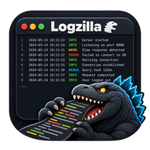

<div align="center">



# Logzilla

**A log analyzer for very large files.**

[](https://github.com/rayonnarain/logzilla/actions/workflows/ci.yml)
[](LICENSE)

</div>

A Windows desktop application for logs that are too big, too many, or too noisy
to work through by hand. It opens multi-gigabyte logs in seconds, merges several
of them onto one timeline, reads structured JSON logs as readable sentences
instead of raw objects, and filters on any field the log records.

It runs entirely on your own machine. Nothing is uploaded anywhere, which matters
when logs carry customer device IDs, hostnames and internal addresses.

---

## Install

Download `Logzilla-Setup.exe` from
[Releases](https://github.com/rayonnarain/logzilla/releases) and run it.

Nothing else is needed. The installer carries the application inside it, the
application bundles its own .NET runtime, and everything is written under your
own profile — so there is no prerequisite to install and no administrator prompt.
Both executables carry full version information, so Windows names the publisher
and version in file properties, Task Manager and the trust prompt.

| | |
|---|---|
| `Logzilla-Setup.exe` | Install |
| `Logzilla-Setup.exe /silent` | Install with no output |
| `Logzilla-Setup.exe /uninstall` | Remove it |
| `Logzilla-Setup.exe /dir=D:\Tools\Logzilla` | Install somewhere else |

It also appears in **Settings › Apps** like any other program.

> **Making it the default for `.log` files**
> Windows deliberately stops an installer from seizing a file association. The
> installer registers the type and adds the app to *Open with*; to finish, right-click
> a `.log` file → **Open with** → **Choose another app** → **Logzilla** →
> tick *Always use this app*. Notepad++ needs the same step.

## What it does

**Reads the whole file, not a window into it.** The file is never fully decoded.
Indexing and search run over raw bytes and only the rows on screen become text,
so file size is bounded by disk rather than memory — about 24 bytes of index per
line. A 1 GB log indexes in roughly nine seconds, and typing in the Find box
never freezes the window: scans run in the background and are abandoned the
moment the query changes.

**Understands the timestamp.** Detected from the file itself, with no
configuration:

| Format | Example |
|---|---|
| ISO 8601 | `2026-03-01 08:14:02.113` |
| Slash dates | `2026/03/01 08:14:02` |
| Apache / IIS (CLF) | `01/Mar/2026:08:14:02 +0000` |
| US short date | `3/1/2026 8:14:02 AM` |
| Syslog | `Mar  1 08:14:02` |
| Time only | `08:14:02.113` (rolls over correctly at midnight) |

Severity is read from the line and shown in its own colour-coded column. UTF-8,
ANSI and UTF-16 (both byte orders) are handled, with byte order marks detected
automatically.

**Merges by time.** Open several logs and press **Merge** in the command bar, or
<kbd>Ctrl</kbd>+<kbd>M</kbd>. Entries interleave onto one timeline with a
colour-coded source column, even when the files use different formats. Stack
traces stay attached to the entry above them, and each source can be hidden or
shown from the Sources panel without redoing the merge. This is what turns "the
gateway logged a timeout" and "the service logged a connection reset" into one
story.

**Reads JSON logs.** Serilog CLEF, pino, bunyan, Elastic ECS and plain NDJSON are
detected from the file itself. Message templates are filled in, so
`{Name}.ProcessMaintenance: {CommandType}` displays as
`MaintenanceCommandManager.ProcessMaintenance: DeviceInformation`. Exceptions are
unescaped into readable text with their real line breaks, and **Show raw lines**
puts the original JSON back whenever you need it.

**Searches whole entries.** `timeout retry` (both words) · `"connection reset"`
(phrase) · `-heartbeat` (exclude) · `.*` (regular expression) · `Aa` (match
case). A query is answered against the whole entry, so a term buried in a stack
trace still finds the error line it belongs to, and two terms count even when
they are several lines apart. **Filter** hides non-matching entries;
**Highlight** keeps them visible and just marks the hits, with optional context
lines around each match.

**Filters by field.** Pick a field the log actually records — `CorrelationId`,
`Feature`, `RequestPath`, a tenant, a status code — and choose **is**,
**contains** or **is not**. Several values on one field match any of them
(`Feature is DeviceAction or Sync`); filters on different fields must all hold.
It works on JSON properties (nested ones too) and on `key=value` pairs in
plain-text logs, and a field on a stack-trace line counts for the entry above
it. Open the editor with **+ Field filter** or
<kbd>Ctrl</kbd>+<kbd>Shift</kbd>+<kbd>F</kbd>; it lists the log's own fields and
values with counts. Active filters show as chips — click to edit, × to remove,
right-click to flip is / is not. Right-click any entry for **Show only where…** /
**Hide where…**, or click a value in the Fields panel. A field filter over a
330 MB log comes back in under half a second.

**Narrows by time.** Drag across the timeline histogram to select a range,
double-click it to clear, click once to jump there. Or type into the **TIME** box
(`20:00 - 21:00`, `8pm - 9pm`, `2026-01-15 08:00 - 09:30`). The Summary panel's
busiest error windows jump straight to the start of an incident.

**Finds the shape of the noise.** The Patterns panel collapses variable parts —
`latency=812ms` and `latency=41ms` become one shape — so a million lines reduce to
a few dozen distinct things ranked by frequency. For CLEF logs the grouping is
exact, because the log already carries the message template. The rare shapes sort
to the bottom, and the rare shapes are usually the problem.

**Selects, marks, copies and exports.** Drag down the rows, Shift+click, or hold
Shift with any movement key to select a run; <kbd>Ctrl</kbd>+<kbd>A</kbd> takes
every entry shown. <kbd>Ctrl</kbd>+<kbd>C</kbd> copies the entries as they read on
screen, one per line, with source labels in a merged view. <kbd>M</kbd> marks the
selection so you can collect the lines that belong in a ticket and copy them all
from the Marks panel later. <kbd>Ctrl</kbd>+<kbd>E</kbd> exports exactly the
filtered entries to a new file, preserving the original text.

**Follows a live file.** **Live tail** keeps reading a log as it is written, like
`tail -f`, with the index extended incrementally.

### The analysis panels

Seven tabs in the inspector, each answering a question about the entries
currently shown. <kbd>Ctrl</kbd>+<kbd>1</kbd>..<kbd>7</kbd> switch between them.

| Panel | What it shows |
|---|---|
| **Summary** | Counts, file size, time span, entries per minute, error count and percentage, a log-scale severity breakdown, and the busiest error windows |
| **Detail** | The selected entry in full: timestamp, severity, byte offset, source, the rendered message, a property table, the exception, and the raw line. Embedded XML (plists, SOAP bodies) is indented |
| **Fields** | Distinct values with counts — JSON property names, `key=value` pairs, IP addresses, `[bracketed tags]`. Click a value to filter to it, Ctrl+click to hide it |
| **Patterns** | Entries grouped by shape, ranked by frequency, coloured by worst severity. Click to jump, Ctrl+click to filter |
| **Marks** | Marked entries in order, ready to copy into a ticket or post-mortem |
| **Sources** | Each file in a merged view with its share of entries; click to show or hide it |
| **Colors** | Text or regex highlight rules, plus saving and loading a setup file (rules, query, levels and field filters) to share with a team |

### Getting around

- **Timeline** — entry volume over time with warnings and errors stacked in
  colour; hover for exact counts.
- **Minimap** — error density for the whole file, not just what is on screen,
  with marks shown in amber. Click to jump.
- **Tabs** — one per open file, with its entry count and worst severity; merged
  views get their own tab.
- **Long lines** — a horizontal scrollbar (and Shift+wheel) reaches anything past
  the right edge, or the **Wrap** chip folds long messages onto several lines.
- **Date** chip — collapses the date-and-time column and gives its width to the
  message; a once-a-day band keeps the date visible.

## Shortcuts

| | |
|---|---|
| <kbd>Ctrl</kbd>+<kbd>O</kbd> / <kbd>Ctrl</kbd>+<kbd>Shift</kbd>+<kbd>O</kbd> | Open files / open every log in a folder |
| <kbd>Ctrl</kbd>+<kbd>M</kbd> | Merge open files onto one timeline |
| <kbd>Ctrl</kbd>+<kbd>F</kbd> or <kbd>/</kbd> | Focus the Find box |
| <kbd>Esc</kbd> | Clear the Find box |
| <kbd>Enter</kbd> / <kbd>Shift</kbd>+<kbd>Enter</kbd>, <kbd>F3</kbd> | Next / previous match |
| <kbd>Ctrl</kbd>+<kbd>Shift</kbd>+<kbd>F</kbd> | Add a field filter |
| <kbd>E</kbd> / <kbd>Shift</kbd>+<kbd>E</kbd> | Next / previous error or worse |
| <kbd>W</kbd> | Show only warnings and above |
| <kbd>M</kbd> | Mark or unmark the selected entries |
| <kbd>B</kbd> / <kbd>Shift</kbd>+<kbd>B</kbd> | Next / previous marked entry |
| <kbd>Ctrl</kbd>+<kbd>G</kbd> | Go to line number |
| <kbd>Ctrl</kbd>+<kbd>R</kbd> | Reset query, levels, field filters and time range |
| <kbd>Ctrl</kbd>+<kbd>A</kbd> / <kbd>Ctrl</kbd>+<kbd>C</kbd> | Select every entry shown / copy the selection |
| <kbd>Ctrl</kbd>+<kbd>Shift</kbd>+<kbd>C</kbd> | Copy every entry shown |
| <kbd>Ctrl</kbd>+<kbd>E</kbd> | Export the entries shown |
| <kbd>Ctrl</kbd>+<kbd>W</kbd> / <kbd>Ctrl</kbd>+<kbd>Tab</kbd> | Close the current tab / cycle tabs |
| <kbd>Ctrl</kbd>+<kbd>1</kbd>..<kbd>7</kbd> | Switch analysis panels |
| <kbd>F5</kbd> / <kbd>F6</kbd> | Re-read from disk / follow the file |
| <kbd>Ctrl</kbd>+<kbd>+</kbd> / <kbd>-</kbd> / <kbd>0</kbd> | Text size |
| <kbd>F1</kbd> | Full shortcut list |

Right-click a severity chip to isolate that level; double-click a word in the grid
to add it to the Find box.

## Accessibility

- Every control exposes a name, role and description to assistive technology,
  and the log grid announces the selected entry as you move through it.
- When Windows is in a high-contrast scheme the dark palette is replaced by the
  system colours, so the user's chosen scheme wins.
- Everything reachable with the mouse is reachable from the keyboard — see the
  shortcut table.
- The whole interface is sized from measured text, so display scaling and
  larger system fonts are respected.

## Configuration

| | |
|---|---|
| Installed to | `%LOCALAPPDATA%\Programs\Logzilla` |
| Settings, window size and recent files | `%APPDATA%\Logzilla` |
| Force a UI scale | `set LOGZILLA_SCALE=1.5` before launching |
| Colour rules, query and filters | **Tools → Save setup** writes a `.cnx` file to share |

## Limits

- JSON support assumes one object per line; pretty-printed JSON is read as text.
- Merging is capped at 12 files.
- Follow works on a single file, not on a merged view.
- Timestamps display exactly as written, with no timezone conversion. Syslog and
  time-only formats carry no year, so the file's last-modified date is used.

## Building from source

Requires only the [.NET SDK 10](https://dotnet.microsoft.com/download) (or
Visual Studio 2022 / Rider). **There is no other tooling to install** — the
installer is a project in this solution rather than a separate product.

```powershell
git clone https://github.com/rayonnarain/logzilla
cd logzilla

dotnet build Logzilla.sln -c Release   # build
dotnet test  Logzilla.sln              # run the unit tests

.\build\build.ps1                      # build, test, publish and package
```

`build.ps1` writes `dist\Logzilla-Setup.exe`. It publishes self-contained and
ReadyToRun by default so the target machine needs no .NET runtime; add
`-FrameworkDependent` for a far smaller build when the runtime is already there,
or `-Runtime win-arm64` to target Arm.

Pushing a tag such as `v2.1.0` makes CI build the installer and attach it to a
GitHub Release. See [CHANGELOG.md](CHANGELOG.md) for what changed in each version.

### How the installer works

`src/Logzilla.Setup` is an ordinary console project. At build time an
MSBuild target zips whatever is in `artifacts\publish` and embeds it as a
resource, so the output is a single self-contained executable. At run time it
extracts to `%LOCALAPPDATA%\Programs\Logzilla`, writes Start Menu and
Desktop shortcuts through the shell's own `IShellLink`, registers the log file
types under `HKEY_CURRENT_USER`, and records an entry for Add/Remove Programs.
Files still locked during uninstall (including the running uninstaller itself)
are scheduled for deletion on the next reboot.

It targets plain `net10.0` rather than `net10.0-windows` because it needs no UI
framework; the Windows-only parts are marked `[SupportedOSPlatform("windows")]`.

## How the code is laid out

Three engine assemblies plus the front end. The split follows the layering
rule: **models and interfaces live in `Core`; concrete classes live in
`Core.Implementation` and are all `internal`**. The only public type in the
implementation is `CoreServices`, the composition root that hosts call.

```
src/
  Logzilla.Core/                  interfaces, models, enums — no UI
    Common/     DisplayFormatter, CivilDate, AsciiTable, Levels, XmlText,
                TimeRangeParser, ICurrentTimeSupplier
    Formats/    TsKind, ITimestampParser, IJsonLogReader
    Logs/       LogSource, LogDocument, ILogIndexer, ILineReader
    Query/      QuerySpec, FilterResult, EntryMatch, FieldFilter, FieldMatch,
                IFilterEngine
  Logzilla.Core.Implementation/   the engine; every type internal
    CoreServices.cs                     composition root
    Formats/    TsParser, LevelScan, JsonLog, JsonLogReader
    Logs/       LogIndexer, LineReader, SourceLabels
    Query/      FilterEngine
  Logzilla.App/                   Windows Forms front end
    Controls/   log grid, timeline, minimap, tab strip, scrollbar,
                field filter chips and editor
    Dialogs/    field filter dialog, prompts
    Infrastructure/ theme, DPI scaling, settings, file associations,
                field catalog, clipboard composition
    Views/      MainForm, split into partial classes
  Logzilla.Setup/                 the installer, built by the .NET SDK
tests/
  Logzilla.Core.Implementation.Tests/   NUnit tests for the engine
  Logzilla.App.Tests/                   NUnit tests for the UI's non-pixel logic
```

`MainForm` takes `ILogIndexer`, `IFilterEngine` and `IJsonLogReader` through
its constructor; `Program` is where they are created. Nothing in the UI refers
to a concrete engine class.

### Design notes worth knowing before you change things

**Warnings are errors.** `TreatWarningsAsErrors` and the .NET analyzers are on
for every project, and `.editorconfig` raises the style rules to error too. A
build that succeeds is therefore already free of the recommended analyzer set,
unused usings, missing braces and implicit accessibility. Suppressing a rule
needs a justification on the attribute.

**Indexing never decodes the file.** `LogIndexer` scans bytes for line
boundaries, the timestamp and the severity word, storing offset, length, level,
time and a flag per line in parallel arrays. `LineReader` turns bytes into a
string only for the rows being drawn. Line breaks, JSON keys and search terms are
found with vectorised span searches. If you add a feature, keep it on that side
of the line — decoding everything is what makes other log viewers fall over.

**An entry is a header line plus its continuations.** Search and field filters
judge the whole entry, so a term on a stack-trace line counts for the error above
it. A passing entry keeps all of its lines; a failing one drops all of them.

**Scans run off the UI thread** with generation-counter cancellation, so typing
in the Find box never blocks the window and a scan is abandoned the moment the
query changes.

**Everything on screen is sized from measured text**, not fixed pixels. That is
what keeps the toolbar readable at 200% display scaling. If you add a control,
size it with `Dpi.S()` and let the layout panels wrap.

**Merging is a k-way merge, not a sort.** Each file is already in time order, so
`LogIndexer.Merge` walks cursors and copies whole entry groups, which keeps stack
traces bonded to their parent line.

## License

MIT — see [LICENSE](LICENSE).
